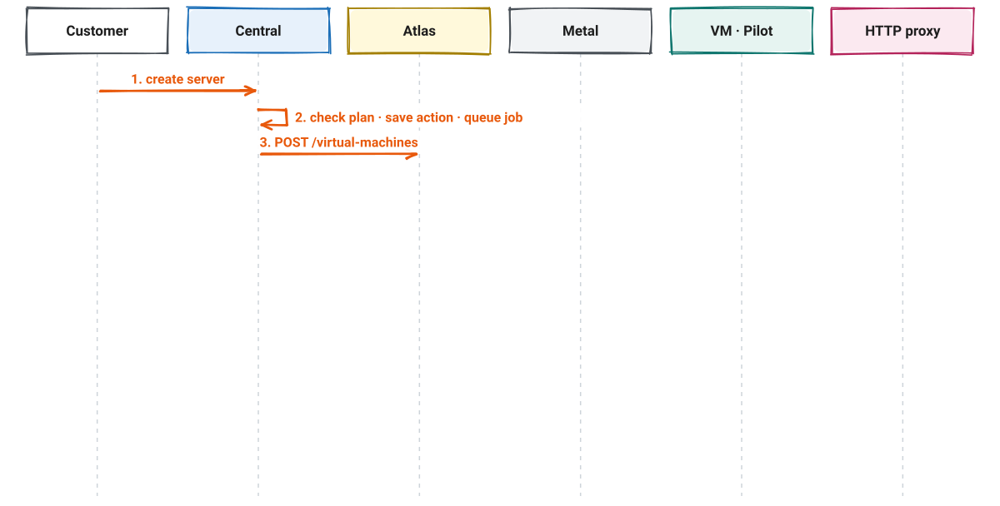
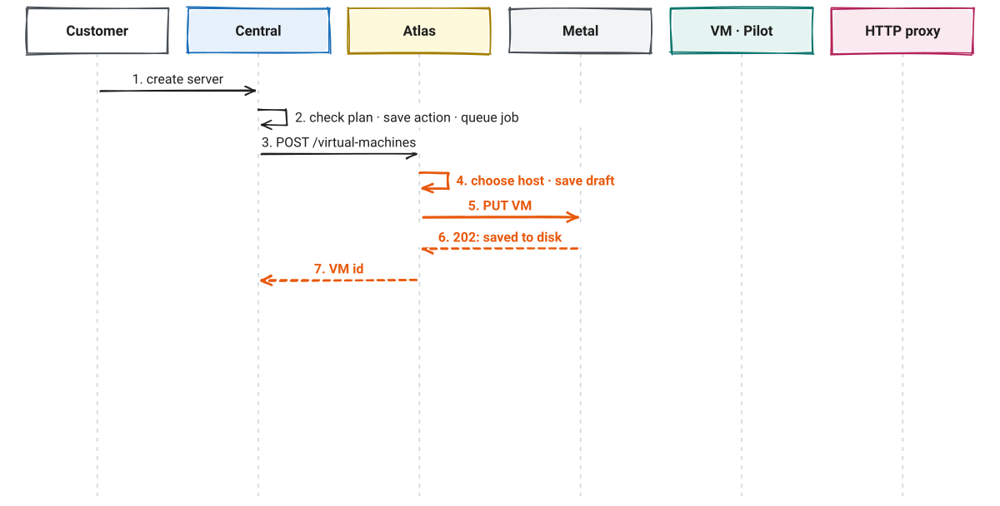
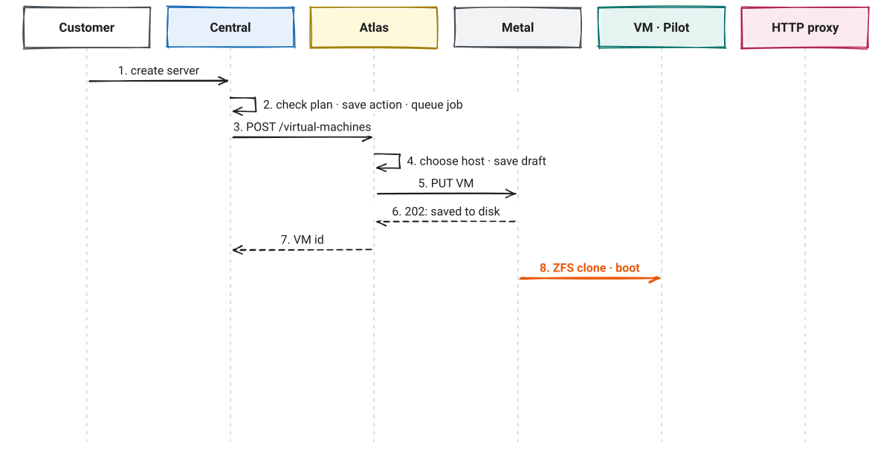
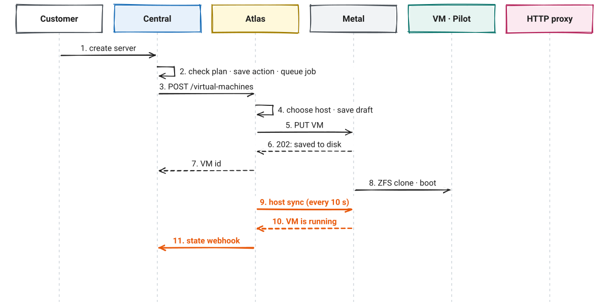
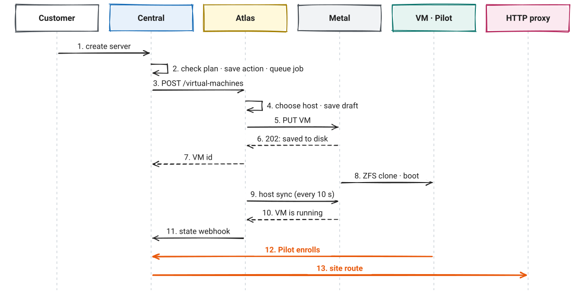
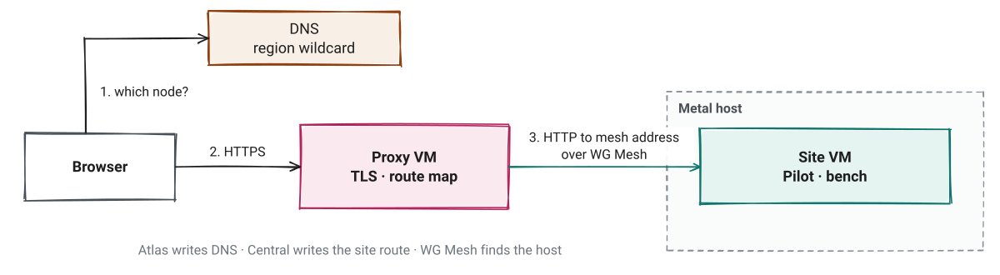
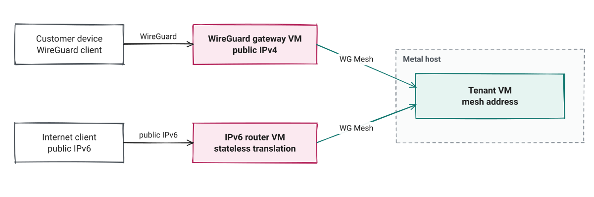
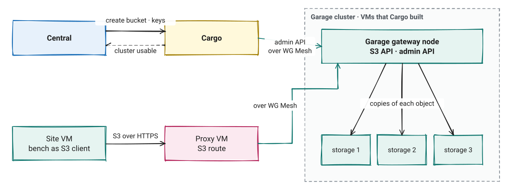

<!-- _class: lead -->
<!-- _paginate: false -->

# Frappe Cloud v2

How the parts connect, from the top down

*Central · Atlas · Cargo · service VMs · Metal · WG Mesh · Pilot*

---

# One click touches many parts

- A customer clicks **Create server** in the dashboard
- A global service records the request
- A regional service selects a host
- A host daemon makes the disk and starts the VM
- A private network gives the VM a fixed address
- The site in the VM must then be reachable from the internet

*This deck shows which part does each job, and which part calls which.*

---

# Three layers

---

# Two kinds of traffic

| | Control traffic | Data traffic |
|---|---|---|
| **What it is** | Requests that change something | Packets to and from sites and VMs |
| **Example** | Create a VM, add a route | A browser opens a site |
| **Parts on the path** | Central, Atlas, Cargo, Metal | Proxy, gateway, router, WG Mesh |

- Central and Atlas are **not** on the data path
- If Central or Atlas stops, running sites continue to work
- If they stop, no customer can make a change

---

<!-- _class: pause -->
<!-- header: '' -->

# Layer 1 · Central

The global control plane

---

<!-- header: '1 · Central' -->

# Central talks to four parties

---

# What Central owns

| Central owns | Central does not own |
|---|---|
| Users, teams, roles and capabilities | Hosts and host selection |
| Plans, billing and limits | VM disks and processes |
| Which region a server goes to | Packets to sites |
| Server, site and domain records | Route storage on proxy nodes |
| Each request as a **Resource Action** | Bucket data |

*Central checks capabilities before every regional call, and the plan before each purchase.*

---

# Central never waits for a host

- Central saves a **Resource Action**, then a background job calls Atlas
- Atlas replies when Metal has saved the request, not when the VM runs
- The final state comes back later in a **state webhook**
- A sweep every 10 minutes reads VM state from Atlas, as a second source

*Push for speed. Poll as a backup.*

---

<!-- _class: pause -->
<!-- header: '' -->

# Layer 2 · Region

One Atlas app and its services in each location

---

<!-- header: '2 · Region' -->

# Atlas makes the regional decisions

---

# Atlas calls Metal. Metal never calls Atlas.

- Atlas sends each VM change to the host over **mutual TLS**
- Every 10 seconds, Atlas sends a **host sync**:
  - Atlas sends peers, network policy and images
  - Metal returns capacity and the state of each VM
- Atlas uses the latest host sync to select hosts
- If Atlas stops, Metal continues with its saved state

*Atlas keeps a cache of VM state. Metal holds the true state.*

---

# Service VMs

Atlas makes these through the same VM service as customer VMs.

| Service | Job | Who calls it | Nodes |
|---|---|---|---|
| **HTTP proxy** | Public web traffic to sites | Browsers; Central and Atlas for routes | 1 to 5 |
| **WireGuard gateway** | Customer devices into private VM addresses | Customer devices | 1 to 5 |
| **IPv6 router** | Public IPv6 to VM mesh addresses | Internet clients | 1 per IPv6 block |
| **Cargo** | Object storage, Pilot images, telemetry hosts | Central, Atlas | 1 Cargo VM + its clusters |

*Service VMs are tenant 0. They can reach VMs of every tenant through WG Mesh.*

---

<!-- _class: seq -->

# Cargo uses Atlas like a customer

---

<!-- _class: pause -->
<!-- header: '' -->

# Layer 3 · Hosts

Metal, Firecracker, ZFS and WG Mesh

---

<!-- header: '3 · Hosts' -->

# Inside two Metal hosts

---

# Metal saves first, then works

- A request writes `config.json`: what must run
- Metal replies `202 Accepted` after the file is saved
- A loop then makes the host match `config.json`
- The loop writes `status.json`: what the host did
- After a crash, Metal continues from these two files

*Each change has a generation number. When observed equals desired, the change is applied.*

---

# WG Mesh: one fixed address per VM

- Each VM gets one private IPv6 address: its **mesh address**
- The address stays the same when the VM moves to another host
- Each pair of hosts shares one **WireGuard tunnel**
- eBPF programs on each host send packets to the correct host
- Hosts learn where a VM is from neighbour discovery, not from a central map

*WG Mesh has no daemon. Metal configures it on each host.*

---

<!-- _class: pause -->
<!-- header: '' -->

# One server, top to bottom

The same diagram, one step at a time

---

<!-- header: 'Create a server' -->
<!-- _class: seq -->

# Central accepts and forwards the request

---

<!-- _class: seq -->

# Atlas selects a host. Metal saves the request.

---

<!-- _class: seq -->

# Metal builds the VM

---

<!-- _class: seq -->

# The state comes back up

---

<!-- _class: seq -->

# Pilot joins and the site gets a route

---

<!-- header: 'Data paths' -->

# A browser opens a site

*The proxy reads only its local route map. No call to Central or Atlas.*

---

# Two more ways into a VM

---

# Buckets: control through Cargo, data through the proxy

---

<!-- header: 'Summary' -->
<!-- _class: small -->

# Who calls whom

| From → to | What | How |
|---|---|---|
| Browser → Central | Dashboard and API | HTTPS |
| Central → Atlas | VMs, images, IPs, snapshots, console tokens | Tenant API, signed token |
| Atlas → Central | VM state changes | Signed webhook |
| Central → Cargo · Cargo → Central | Buckets and keys · cluster state | Signed token · signed webhook |
| Central → HTTP proxy | Site and domain routes | Proxy control API |
| Central ↔ Pilot | Login, rename · enroll, heartbeat, domains | HTTPS |
| Cargo → Atlas | Machines for storage and image builds | Tenant API as tenant 0 |
| Atlas → Metal | VM changes, host sync every 10 s | Mutual TLS |
| Atlas → service VMs | Install and configuration | SSH through the host |
| Metal ↔ Metal | Migration | Coordination API, TLS disk stream |
| Metal → object storage | Image download, snapshot upload | Signed URLs |
| Atlas, Metal → Datum | Metrics and logs | HTTPS push |

---

<!-- _class: small -->

# Where state lives

| State | Owner | After a crash |
|---|---|---|
| Users, plans, requests | Central database | Jobs continue from saved Resource Actions |
| Regional requests, host choice | Atlas database | Atlas jobs continue from saved records |
| What a host must run | Metal `config.json` | Metal continues unfinished work |
| What a host did | Metal `status.json` | Metal reads it at start |
| Disks and images | ZFS on each host | Metal continues storage work |
| Route maps | Each proxy node | Nodes elect a leader and repair stale nodes |
| VM locations | WG Mesh maps on each host | Hosts learn locations again |
| Objects | Garage storage nodes | Copies on other nodes |

---

<!-- header: '' -->

# Sources

- Atlas handbook: `docs/start/architecture.md`, `docs/start/how-a-vm-request-works.md`
- Region and services: `docs/region/service-vms.md`, `docs/region/cargo.md`, `docs/region/host-sync.md`
- Networking: `docs/networking/` (HTTP proxy, WG Mesh, WireGuard gateway, IPv6 router)
- Cargo contracts: `docs/atlas-contract.md`, `docs/central-contract.md`
- Central: `CAPABILITIES.md`, `central/integrations/`, `central/api/state_delivery.py`

*Related decks: [Atlas HTTP proxy](../atlas-http-proxy/) · [Atlas WG Mesh](../atlas-wg-mesh/)*
