<!-- _class: lead -->
<!-- _paginate: false -->

# ublk and io_uring

How a block device runs in a normal process,
and how zero-copy removes the data copy

*Examples from mica, a disk that keeps its data in S3*

---

# The problem

- A **block device** is a disk that Linux shows as a file, such as `/dev/sda`
- A filesystem or a VM reads and writes it in blocks of 512 bytes or more
- Usually a **kernel driver** serves these reads and writes
- Mica must serve them from local files and from S3, with caching and crash safety
- That logic is too large and too risky for the kernel

*We want the kernel to give each read and write to a normal program, and give back the answer.*

---

# Two parts make this possible

| Part | Job | In Linux since |
|---|---|---|
| **io_uring** | A fast way for a program to send work to the kernel and get results | 5.1 (2019) |
| **ublk** | A kernel driver that sends block requests to a program through io_uring | 6.0 (2022) |

- The program that serves the device is called the **ublk server**
- In this deck, the ublk server is **mica**

---

<!-- _class: pause -->
<!-- header: '' -->

# Part 1 · io_uring

Send many I/O requests, wait once

---

<!-- header: '1 · io_uring' -->

# One system call for each I/O is slow

- A normal `read()` is a **system call**: the program stops, the kernel works, the program continues
- Each system call costs time to enter and leave the kernel
- A program that waits for one read cannot start the next read
- Many threads can wait in parallel, but threads cost memory and CPU

*io_uring lets one thread have many reads and writes in flight, with few system calls.*

---

# Two rings in shared memory

- **Submission queue (SQ)**: the program writes requests here
- Each request is a **submission queue entry (SQE)**
- **Completion queue (CQ)**: the kernel writes results here
- Each result is a **completion queue entry (CQE)**
- Both rings are memory that the program and the kernel share, so adding a request or reading a result needs no system call

---

<!-- _class: seq -->
<!-- _transition: fade -->

# A read with io_uring · step 1

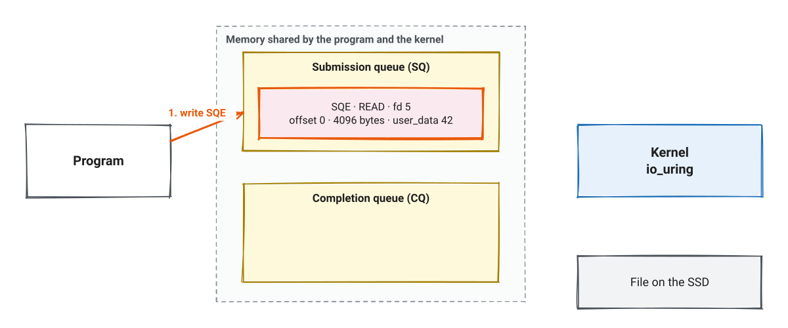

The program writes an SQE into the submission queue. It is only a memory write.

---

<!-- _class: seq -->
<!-- _transition: fade -->

# A read with io_uring · step 2

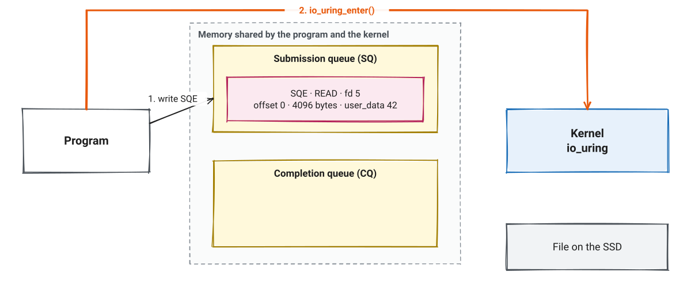

One `io_uring_enter()` call tells the kernel about all new SQEs, not only one.

---

<!-- _class: seq -->
<!-- _transition: fade -->

# A read with io_uring · step 3

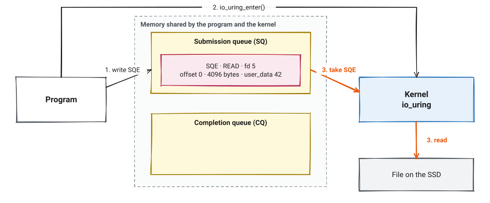

The kernel takes the SQE and starts the read. The program can do other work.

---

<!-- _class: seq -->
<!-- _transition: fade -->

# A read with io_uring · step 4

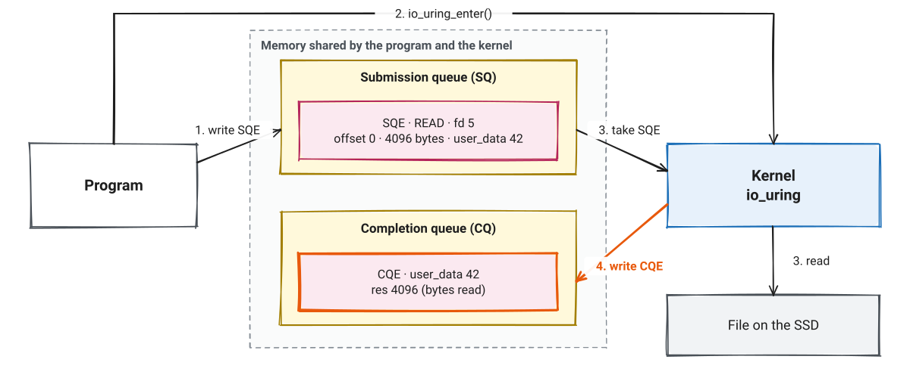

The kernel writes a CQE. `res` is the result: bytes done, or a negative error number.

---

<!-- _class: seq -->
<!-- _transition: fade -->

# A read with io_uring · step 5

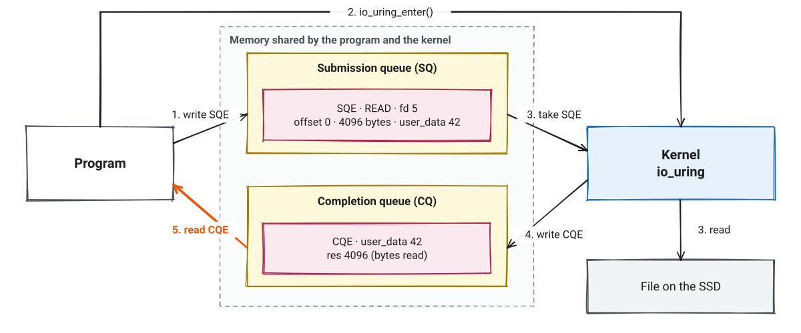

The program reads the CQE. `user_data` is a number the program chose, so it knows which request finished.

---

# Registered buffers

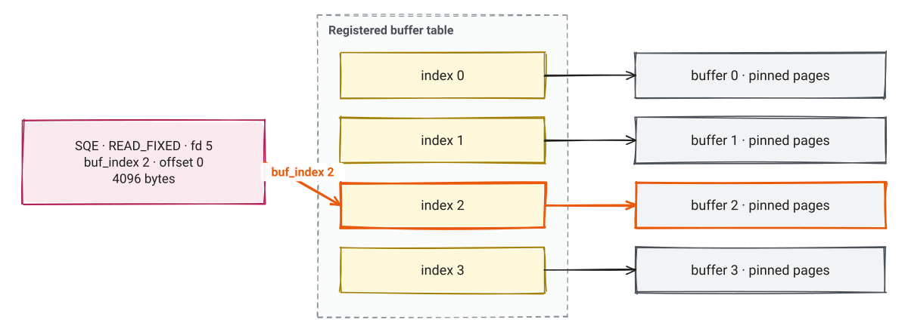

- A program can **register** buffers once, in a table with an index for each buffer
- `READ_FIXED` and `WRITE_FIXED` name a buffer by its index, not by an address
- *Keep this table in mind. ublk zero-copy puts block requests into it.*

---

# A command for a driver: uring_cmd

- io_uring also has a generic operation for drivers: **`IORING_OP_URING_CMD`**
- The driver decides what the command means
- A uring_cmd can stay in flight for a long time, and complete only when the driver has news
- ublk uses this: the server sends one command for each request slot, and the command completes when a block request arrives

---

<!-- _class: pause -->
<!-- header: '' -->

# Part 2 · ublk

A block device whose logic runs in a program

---

<!-- header: '2 · ublk' -->

# The parts of ublk


---

# Three device files

| File | Who uses it | For what |
|---|---|---|
| `/dev/ublk-control` | ublk server | Make, start, stop and delete devices |
| `/dev/ublkcN` | ublk server | I/O commands, and the table of request descriptions |
| `/dev/ublkbN` | Application | The block device: a filesystem, `fio`, or a VM disk |

*N is the device number. Mica also makes a stable link: `/dev/mica/<disk-id>`.*

---

# Queues and tags

- A device has one or more **queues**. Each queue has a fixed number of **tags**
- A tag is a request slot: one block request in flight at a time
- For each tag, the server keeps **one uring_cmd in flight**
- Mica uses up to **4 queues × 64 tags**, one thread for each queue

```rust
UblkCtrlBuilder::default()
    .nr_queues(queue_count())          // up to 4
    .depth(QUEUE_DEPTH)                // 64 tags
    .io_buf_bytes(IO_BUFFER_BYTES)     // 512 KiB, the largest request
    .ctrl_flags(UBLK_F_USER_RECOVERY | UBLK_F_USER_RECOVERY_REISSUE)
```

---

# Start a device

1. Send `ADD_DEV` on `/dev/ublk-control`: queues, tags, largest request size
2. Send `SET_PARAMS`: size, block size, discard, write cache
3. For each tag, send `FETCH_REQ` on `/dev/ublkcN`: "give me a request"
4. Send `START_DEV`. The kernel makes `/dev/ublkbN`

*`SET_PARAMS` must come before `START_DEV`.*

---

# The request description

Each tag has a slot in a table that the server maps from `/dev/ublkcN`. The kernel fills it before it tells the server about a request.

```c
struct ublksrv_io_desc {
    __u32 op_flags;      /* READ, WRITE, FLUSH, DISCARD ... plus FUA */
    __u32 nr_sectors;    /* length, in 512-byte sectors */
    __u64 start_sector;  /* position on the disk */
    __u64 addr;          /* server buffer for the data */
};
```

*The server finds the slot from the queue number and the tag.*

---

<!-- _class: seq -->
<!-- _transition: fade -->

# A read through ublk · step 1

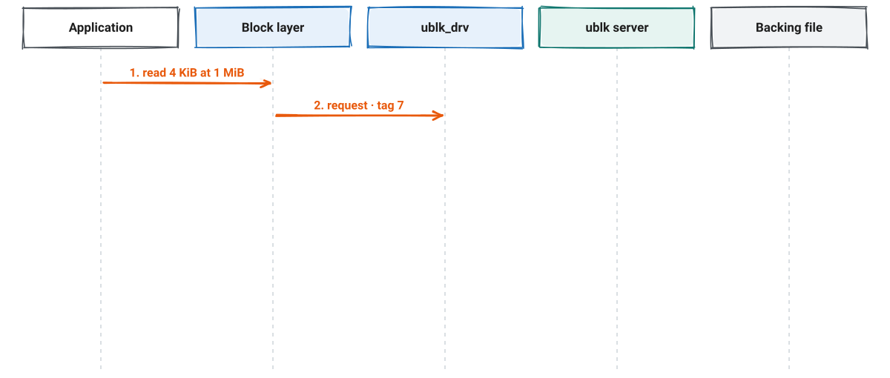

The application reads 4 KiB. The block layer makes a request and gives it tag 7.

---

<!-- _class: seq -->
<!-- _transition: fade -->

# A read through ublk · step 2

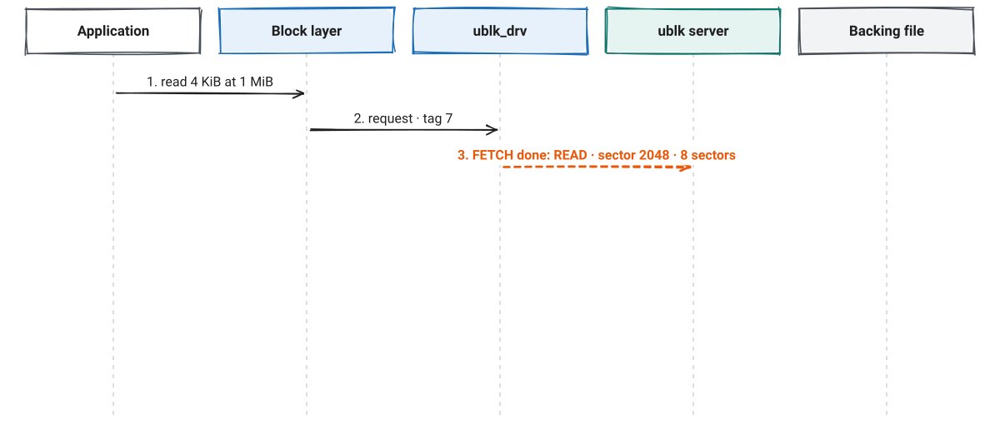

ublk_drv fills the description of tag 7 and completes its waiting FETCH command. The server gets a CQE.

---

<!-- _class: seq -->
<!-- _transition: fade -->

# A read through ublk · step 3

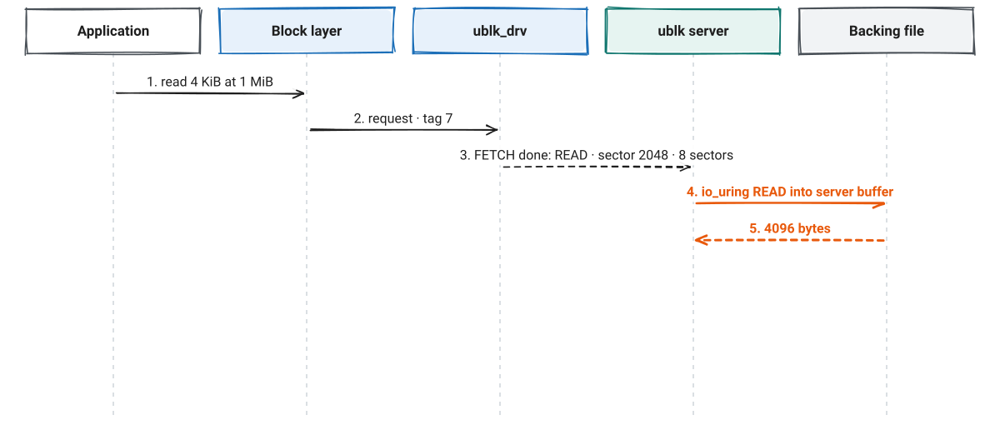

The server reads the data into **its own buffer** for tag 7. In mica this is an io_uring read on the same ring.

---

<!-- _class: seq -->
<!-- _transition: fade -->

# A read through ublk · step 4

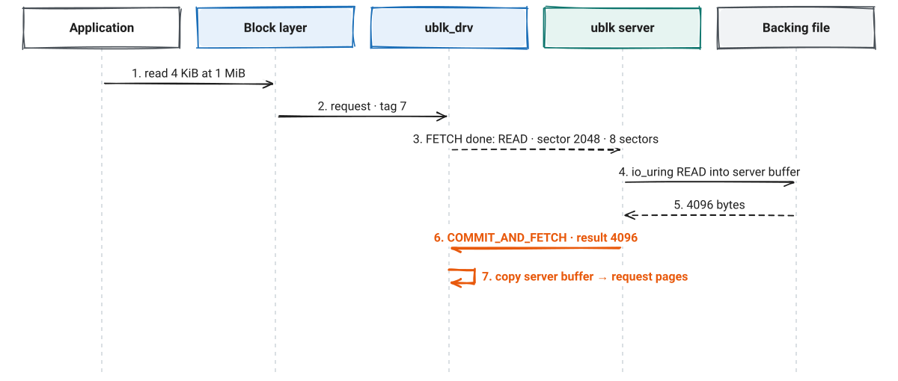

`COMMIT_AND_FETCH` gives the result. **The kernel then copies the server buffer into the request.**

---

<!-- _class: seq -->
<!-- _transition: fade -->

# A read through ublk · step 5

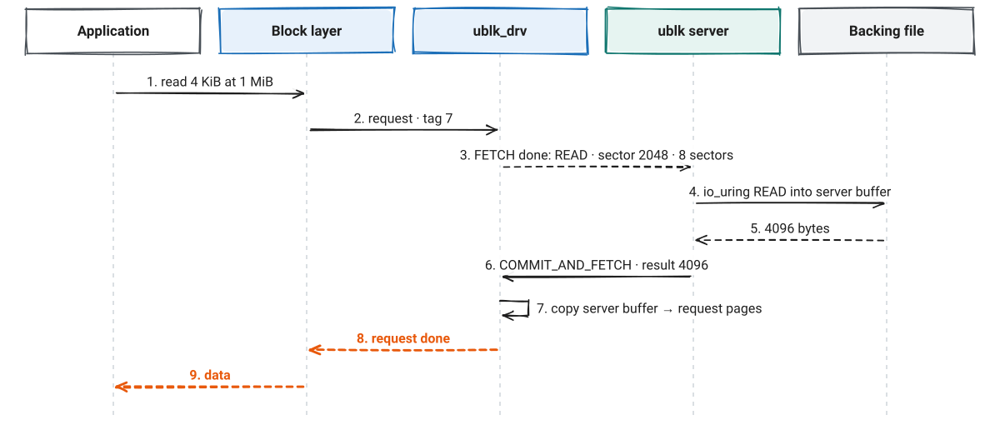

The request completes. The same command now waits for the next request on tag 7: one command does both jobs.

---

# A write goes the other way

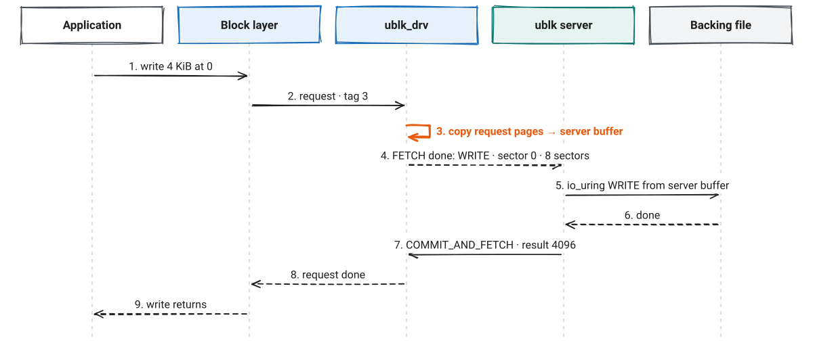

For a write, the kernel copies the data into the server buffer **before** it tells the server.

---

# How mica serves a request


*Most requests on a warm disk never leave the queue thread.*

---

# When the server stops


- With `USER_RECOVERY`, the device stays and the application only waits
- `REISSUE` sends requests again that the old server had. The backend must accept the same write twice. Mica does

---

<!-- _class: pause -->
<!-- header: '' -->

# Part 3 · Zero-copy

Read and write the request pages directly

---

<!-- header: '3 · Zero-copy' -->

# Where the copies are


- Copy mode: every tag needs a server buffer as large as the largest request
- Mica: 4 queues × 64 tags × 512 KiB = **up to 128 MiB for each disk**

---

# The idea

- The request already has pages in the kernel
- Put those pages into the **registered buffer table** of the server's ring
- Then `READ_FIXED` and `WRITE_FIXED` use them, the same as any registered buffer
- The server never sees the data in its own memory

*The server must be trusted: for a read, it must fill every byte it reports. Otherwise old kernel memory leaks to the application. So zero-copy needs `CAP_SYS_ADMIN`.*

---

# First version: register by hand

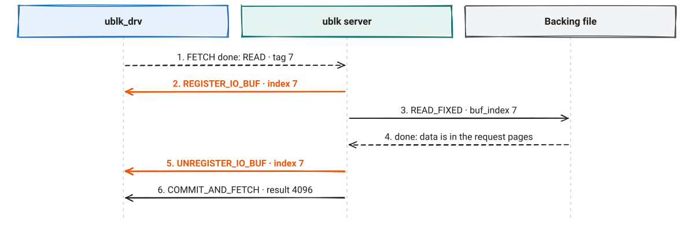

Flag `UBLK_F_SUPPORT_ZERO_COPY`. Two extra commands for each request, and the file read must wait for the register command.

---

# Second version: automatic registration

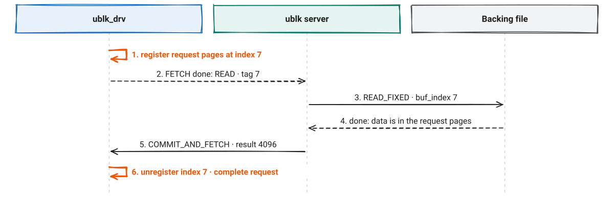

Flag `UBLK_F_AUTO_BUF_REG`. The kernel registers before it sends the request, and unregisters at commit. The author reported **50% more IOPS** than the first version, in a test VM.

---

# Rules of automatic registration

- The server makes a **sparse buffer table** on the same ring that sends the FETCH commands
- It gives the index in each FETCH and COMMIT command: mica would use the tag
- Every operation on the buffer must finish **before** the commit, because the commit unregisters it
- If registration fails:
  - With `UBLK_AUTO_BUF_REG_FALLBACK`, the request arrives with `UBLK_IO_F_NEED_REG_BUF` set
  - Without it, the request fails, and the server is not told

---

# When the data is not in a file: user copy

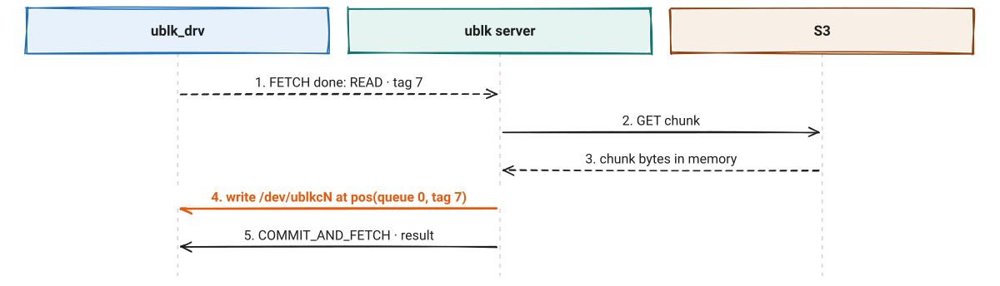

With `UBLK_F_USER_COPY`, the server reads or writes the request pages with `pread` and `pwrite` on `/dev/ublkcN`. The file position encodes the queue, the tag and an offset.

---

# Measured by the ublk author

<!-- _class: small -->

Null target (no real storage), `fio/t/io_uring` on `/dev/ublkb0`, 16 queues:

| Jobs | Copy | Zero-copy (auto) | Change |
|---|---|---|---|
| 1 | 2.54 M IOPS | 3.13 M IOPS | +23% |
| 16 | 37.77 M IOPS | 42.83 M IOPS | +13% |

- These numbers show the cost of ublk itself
- With real storage, the storage is slower, so the gain is smaller
- *From the `UBLK_F_BATCH_IO` patch posting, Nov 2025. The percentages are computed here.*

---

# The plan for mica

<!-- _class: small -->

| Request | Now | With zero-copy |
|---|---|---|
| Local read | io_uring `READ` into the tag buffer | `READ_FIXED` into the request pages |
| Local read of a part never written | `memset` the tag buffer | `READ_FIXED` from `/dev/zero` |
| Local write | io_uring `WRITE` from the tag buffer | `WRITE_FIXED` from the request pages |
| Read from S3 | copy into the tag buffer | `write` to `/dev/ublkcN` (user copy) |
| Write to a chunk not local, FUA write | copy out of the tag buffer | `read` from `/dev/ublkcN` (user copy) |

- Flags: `AUTO_BUF_REG | USER_COPY`, plus the recovery flags. With the fallback flag, a failed registration falls back to user copy
- Expected: almost no buffer memory for each disk. A small CPU gain
- *Not built yet. The first step checks that the lab kernel accepts these flags together.*

---

# Other modes, not used by mica

- **`UBLK_F_BATCH_IO`**: one command for many requests of a queue, in place of one command for each tag. Any thread can serve any request
- **`UBLK_F_SHMEM_ZC`**: the application and the server share memory. Only for direct I/O from a cooperating application
- **`UBLK_F_NEED_GET_DATA`**: an old way to give the write buffer later. Kept for old servers

---

# Read more

- Kernel documentation: [ublk](https://docs.kernel.org/block/ublk.html)
- Jens Axboe: [Efficient IO with io_uring](https://kernel.dk/io_uring.pdf)
- LWN: [ublk: support to register bvec buffer automatically](https://lwn.net/Articles/1020732/) (May 2025)
- LWN: [ublk: add UBLK_F_BATCH_IO](https://lwn.net/Articles/1046200/) (Nov 2025)
- LPC 2024: [ublk zero copy slides](https://lpc.events/event/18/contributions/1710/)
- Flags and their rules: [`include/uapi/linux/ublk_cmd.h`](https://github.com/torvalds/linux/blob/master/include/uapi/linux/ublk_cmd.h)
- Rust library used by mica: [libublk-rs](https://github.com/ublk-org/libublk-rs) · C server and library: [ubdsrv](https://github.com/ming1/ubdsrv)
- Papers on io_uring: Didona et al., *Understanding Modern Storage APIs* (SYSTOR 2022) · Haas and Leis, *What Modern NVMe Storage Can Do, and How to Exploit It* (VLDB 2023)
