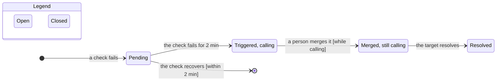

# State chart

A state chart shows how a system moves between states, in the words of the person who reads it. That person, the reader, decides whether the behavior is correct. You write the chart by hand. Nothing checks it for you, so do the check in step 3 with care.

## Steps

1. **Find the states.** Read the code, the plan or the user's text. Name each state with what the reader can see or cares about, such as "Paying" or "Lease held, write pending". Keep variable names out of the labels. Put the states in 2 to 4 phases, such as open and closed.
2. **Write the rules.** A rule is a sentence that must be true in each state, such as "No call starts after a person answers". Ask the user for rules that you cannot find. Never weaken a rule to make it hold.
3. **Check each rule.** For each state, list each step out of it. For each step, check each rule in the next state. A rule that is false in a state breaks there. For each broken rule, find the shortest path from the start. Also find each state that has no step out but is not an end state, and each loop that never reaches an end.
4. **Write the chart.** Use the template below.
5. **Give the result.** See "Output".

## Template



- Give each state a short lowercase id, and its label with `id: Label`.
- Write each step as the reader sees it happen, such as "you press play" or "the connect fails". Do not name the function or the event in the code.
- When a step can occur only in some conditions, end its label with the condition in brackets, such as `[while the file loads]`.
- When two steps end the same in the chart, give them one label, so that they share one arrow.
- Put the Legend first and the `class` lines last. The Legend has one key for each phase. The site build moves the Legend under the chart and adds the keys for the marks.
- Use `direction LR`. The site build turns a chart that is too wide into a vertical chart.
- For parts that change at the same time, such as a connection and a sync, use one region for each part: a composite state with `--` between the regions.

### Classes

| Class | Use it for |
| --- | --- |
| `blue` `teal` `orange` `purple` `yellow` `tan` `pink` `gray` | One phase. Open states blue and closed states teal is a good default. |
| `breaks` | A state where a rule is false. |
| `mayBreak` | A state where a rule is false in some cases only. |
| `bugPath` | Each state on the shortest path to a `breaks` state. |
| `repeats` | Each state in a loop that never reaches an end. |

Do not use `classDef` or `style` colors. The kit sets the colors for light and dark.

### Size

Aim for 12 states and 20 arrows or fewer. When the chart is busier, merge states that act the same for the reader, and leave out steps that change nothing the reader cares about. Keep each state of a bug path. Do not merge two states that break different rules. Say which steps the chart leaves out.

## Output

**In chat:** give the chart as a `mermaid` code block. Then give one line for each broken rule: the rule, and the path as numbered states.

**On sites.tanmoysarkar.me:** follow the tanmoy-publish skill. Put this in the page:

```html
<script type="text/mermaid" data-label="Incident state chart" data-caption="Blue states are open. Green states are closed. The red state breaks a rule.">
stateDiagram-v2
  ...
</script>

<h2>Rules</h2>
<table>
<thead><tr><th>Rule</th><th>Means</th><th>Result</th></tr></thead>
<tbody>
<tr><td>Calls stop after an answer</td><td>No call starts after a person answers or merges.</td><td><span class="tag bad">Breaks</span></td></tr>
<tr><td>Every incident ends</td><td>Each path reaches Resolved.</td><td><span class="tag ok">Holds</span></td></tr>
</tbody>
</table>

<h2>Path to the bug</h2>
<ol class="trace">
<li><b>Pending</b><span>a check fails</span></li>
<li><b>Triggered, calling</b><span>the check fails for 2 min</span></li>
<li class="bad"><b>Merged, still calling</b><span>a person merges it while the call loop runs, so it calls again.</span></li>
</ol>
```

Give one `ol.trace` for each broken rule. Add a summary at the top of the page: the number of states, the number of rules that hold, and the fix.

**As an image:** write the chart to `chart.mmd`, then run:

```sh
node <skill dir>/scripts/render.mjs chart.mmd
```

It writes `chart.svg` next to the file. The SVG has the site colors and follows the light or dark setting of the viewer. The first run installs Pele into `~/.cache/tanmoy-state-chart` and needs the network.

## Hand off

- Say that you checked the rules by hand, and what the chart leaves out.
- When the chart describes code, test each bug path against the real code, one step for each arrow. If a bug does not occur, think that the chart is wrong until you show that it is not.
